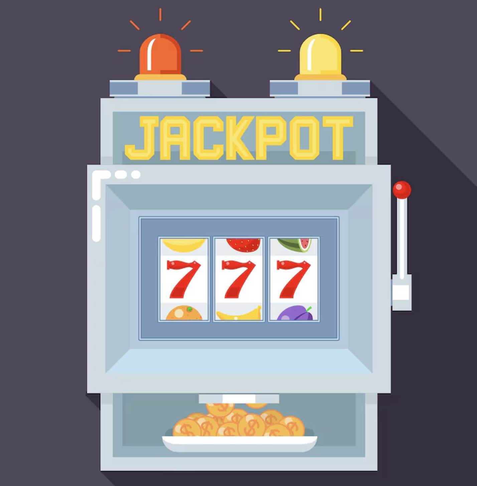

# Slot Machine

A simple browser-based slot machine game built with HTML, CSS, and JavaScript. Players can place bets, spin three reels, and try to match symbols to win.

### Live Demo

**[Play Slot Machine](https://anwaralshohatee.github.io/slot-machine/)**

### Features

- Three reels with five possible symbols each
- Randomized spins using JavaScript
- Bet amounts between $5 and $50
- Starting balance of $100
- $50 payout for matching all three symbols
- Balance updates after wins and losses
- Restart option when the balance runs out

### 🛠️ Tech Stack

- **HTML5:** Game structure
- **CSS3:** Layout and styling
- **JavaScript:** Game logic, randomization, and DOM manipulation

### Getting Started

1. Clone the repository:

   ```bash
   git clone https://github.com/AnwarAlshohatee/slot-machine.git
   ```

2. Open the `slot-machine` folder.
3. Open `index.html` in your browser.

No installation or additional dependencies are required.

### Screenshot



### Author

**Anwar Alshohatee**

[GitHub](https://github.com/AnwarAlshohatee) | [Portfolio](https://anwaralshohatee.netlify.app)
